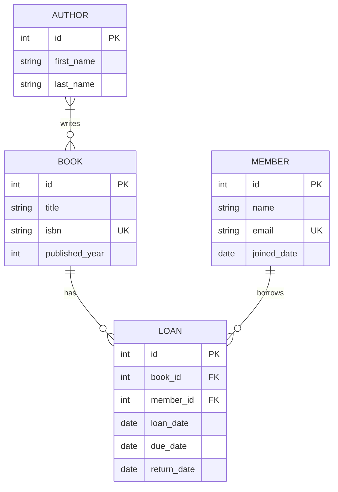

# Library Management System - ER Diagram

## Checkpoints

### 1. How many relationship lines touch Loan, and which cardinality is written at each end?

Two relationship lines touch the Loan entity:

- Book - Loan: one book can have zero or many loans, while each loan references exactly one book.
- Member - Loan: one member can have zero or many loans, while each loan belongs to exactly one member.

Both relationships are one-to-many (1:N).

### 2. Which representation did you choose for Author-Book?

I chose a direct many-to-many relationship between Author and Book.

A book must have one or more authors, while an author can have zero or more registered books.

The direct many-to-many relationship is closer to the conceptual ER diagram in Chen notation.

An explicit BOOK_AUTHOR associative table is closer to the relational schema because relational databases implement many-to-many relationships using join tables.

